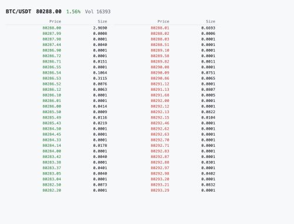

# Order Book

A browser-based BTC/USDT order book built with React and TypeScript. It combines a Binance REST snapshot with updates from the `@depth@100ms` WebSocket stream and keeps both sides of the book synchronized by update ID.



## What it handles

- Deltas received before the REST snapshot are buffered and replayed after it arrives.
- Stale updates are ignored. A gap in update IDs starts a fresh synchronization cycle.
- The WebSocket reconnects with exponential backoff.
- After repeated WebSocket failures, the app switches to a synthetic feed and marks it as demo data.
- Market updates are applied to the Zustand store once per animation frame.
- The UI renders the best 30 bid and ask levels.

The market data code is separated from the store and React components by the `MarketDataSource` interface. The reconciler contains no network or timer code, which keeps its behavior deterministic in tests. See [the architecture notes](docs/architecture.md) for the module boundaries and synchronization flow.

## Run locally

```bash
npm install
npm run dev
```

The development server runs at `http://localhost:5173`.

## Tests and production build

```bash
npm test
npm run build
```

The test suite contains 43 tests across 9 files. It covers payload validation, snapshot and delta reconciliation, reconnection, source orchestration, fallback behavior, store batching, and the main UI components.

## Stack

React 18, TypeScript in strict mode, Vite, Zustand, Vitest, and Testing Library. The project does not use a chart library or component framework.

## Current scope

The app supports BTC/USDT from Binance and displays the order book and 24-hour ticker data. Trades, candlesticks, pair selection, price grouping, and multi-exchange aggregation are possible follow-up features.
